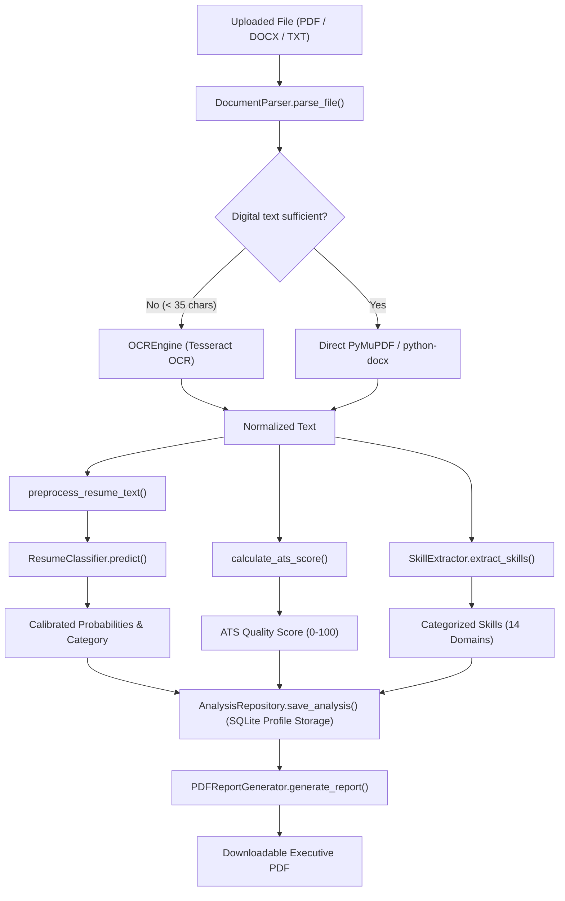

# CODEBASE GUIDE: ARCHITECTURE & TECHNICAL REFERENCE

This document provides a comprehensive architectural and module-level reference for the **Resume Intelligence Platform**. It is intended to allow faculty members, evaluators, and engineers to understand the code organization, data flow, mathematical algorithms, and implementation details.

---

## 1. Complete Final Directory Hierarchy

```
Resume Classification Sysytem Project/
│
├── app.py                          # Streamlit Main Dashboard & Navigation Router
├── README.md                       # High-level overview, installation & user guide
├── CODEBASE_GUIDE.md               # Detailed module-by-module code reference (this file)
├── MODEL_EVALUATION_RESULTS.txt    # Official empirical training benchmark outputs
├── requirements.txt                # Production dependency manifest
├── pytest.ini                      # Automated test configuration
├── .gitignore                      # Git exclusion rules
├── .env.example                    # Environment variable configuration template
│
├── config/
│   └── settings.py                 # Central configuration: paths, limits, model constants
│
├── ui/                             # Presentation Layer (Streamlit Pages)
│   ├── styles.py                   # Enterprise visual theme, CSS rules, badges
│   ├── dashboard.py                # Page 1: Overview Dashboard (KPIs, Plotly charts)
│   ├── analyzer.py                 # Page 2: Resume Analyzer (Upload, OCR, ATS Score)
│   ├── job_match.py                # Page 3: Job Match Studio (JD alignment)
│   ├── history.py                  # Page 4: History & Side-by-Side Comparison
│   ├── model_lab.py                # Page 5: Model Laboratory (Benchmarking metrics)
│   ├── reports.py                  # Page 6: PDF Reports Repository
│   └── docs.py                     # Page 7: Technical Documentation View
│
├── core/                           # Business & Computational Core
│   ├── ingestion/
│   │   ├── parser.py               # DocumentParser: handles TXT, DOCX, Digital PDF
│   │   └── ocr.py                  # OCREngine: Tesseract OCR fallback wrapper
│   ├── preprocessing/
│   │   ├── text_cleaner.py         # Unicode, tech token preservation, regex extraction
│   │   └── normalizer.py           # Tokenization, domain stopwords, lemmatization
│   ├── features/
│   │   ├── tfidf_builder.py        # TF-IDF builders: Word, Char, FeatureUnion
│   │   └── skill_extractor.py      # Taxonomy-driven skill extractor (14 categories)
│   ├── classification/
│   │   ├── predictor.py            # ResumeClassifier: calibrated probability inference
│   │   └── explainability.py       # Attribution term importance extraction
│   ├── scoring/
│   │   ├── ats_scorer.py           # 6-dimension explainable ATS score (0-100)
│   │   └── job_matcher.py          # Candidate-to-job description matcher
│   ├── analytics/
│   │   └── metrics_aggregator.py   # Historical analytics & comparison matrices
│   └── reporting/
│       └── pdf_generator.py        # Executive ReportLab PDF generator
│
├── data_access/                    # Persistence Layer
│   ├── database.py                 # SQLite connection & schema initialization
│   ├── profile_repository.py       # Local profile management
│   └── analysis_repository.py      # Profile-isolated analysis records
│
├── training/                       # ML Experimentation & Training Pipeline
│   ├── dataset_audit.py            # Dataset distribution & integrity audit
│   ├── compare_features.py         # 5-fold CV feature engineering comparison
│   ├── train_models.py             # Model training, calibration & benchmark
│   └── evaluate_models.py          # CLI metrics inspector
│
├── data/                           # Data Assets
│   ├── raw/resume_dataset.csv      # Standard 9-category benchmark dataset
│   ├── external/                   # Mapped real-world resumes
│   ├── processed/                  # Preprocessed training dataset
│   └── skills.json                 # Structured skills taxonomy & aliases
│
├── artifacts/                      # Production Model Artifacts
│   ├── champion_model.joblib       # Calibrated LinearSVC classifier pipeline
│   ├── tfidf_vectorizer.joblib     # Fitted TF-IDF vectorizer (5,000 features)
│   └── model_metadata.json         # Evaluation metrics, classes, hyperparameters
│
├── evaluation/                     # Benchmark Outputs
│   ├── model_comparison.csv        # Metrics table (Acc, F1, Latency)
│   ├── model_comparison.json       # Structured benchmark outputs
│   ├── per_class_metrics.csv       # Precision, Recall, F1 for 9 categories
│   ├── confusion_matrix.json       # Confusion matrices for all models
│   └── feature_comparison.csv      # Word vs Char vs Hybrid CV results
│
├── tests/                          # Automated Pytest Suite (23 Tests)
│   ├── test_ingestion.py           # File parsing, empty docs, OCR detection
│   ├── test_nlp_features.py        # Tech tokens, normalization, taxonomy
│   ├── test_classification.py      # Inference, calibration, class shapes
│   ├── test_scoring.py             # ATS score bounds, job description match
│   ├── test_database.py            # Persistence, profile isolation, CRUD
│   └── test_pdf_report.py          # ReportLab PDF creation & byte validation
│
└── scripts/
    └── setup_check.py              # System environment & dependency check
```

---

## 2. Core Execution Entry Points

### Application Entry Point
- **File:** [`app.py`](file:///c:/Users/nimma/OneDrive/Desktop/Resume%20Classification%20Sysytem%20Project/app.py)
- **Invocation:** `streamlit run app.py`
- **Responsibility:** Configures page layout, injects custom CSS styling, provides the sidebar profile manager, and dispatches requests to the 7 dedicated UI page controllers.

### Model Training Entry Point
- **File:** [`training/train_models.py`](file:///c:/Users/nimma/OneDrive/Desktop/Resume%20Classification%20Sysytem%20Project/training/train_models.py)
- **Invocation:** `python training/train_models.py`
- **Responsibility:** End-to-end training pipeline. Audits data, partitions stratified train/test splits, fits vectorizers on training data only, benchmarks 5 candidate models, performs 5-fold CV on feature variants, exports champion artifacts, and generates `MODEL_EVALUATION_RESULTS.txt`.

---

## 3. Module-by-Module Technical Specification

### A. Configuration Layer (`config/`)

#### [`config/settings.py`](file:///c:/Users/nimma/OneDrive/Desktop/Resume%20Classification%20Sysytem%20Project/config/settings.py)
- **Responsibility:** Central configuration hub resolving file paths dynamically relative to project root.
- **Key Variables:**
  - `BASE_DIR`: Absolute path to project root.
  - `RAW_DATA_PATH`, `PROCESSED_DATA_PATH`, `SKILLS_TAXONOMY_PATH`.
  - `CHAMPION_MODEL_PATH`, `VECTORIZER_PATH`, `MODEL_METADATA_PATH`.
  - `DATABASE_PATH`: SQLite database file path (`database/resume_intelligence.db`).
  - `MAX_FILE_SIZE_BYTES`: Enforces 10 MB maximum upload size limit.
  - `TESSERACT_CMD`: Dynamic detection of Tesseract binary via environment variables, `shutil.which`, or standard Windows paths.
  - `TARGET_CATEGORIES`: 9 target job classifications.

---

### B. Document Ingestion Layer (`core/ingestion/`)

#### [`core/ingestion/ocr.py`](file:///c:/Users/nimma/OneDrive/Desktop/Resume%20Classification%20Sysytem%20Project/core/ingestion/ocr.py)
- **Class:** `OCREngine`
- **Responsibility:** Wraps `pytesseract` to provide optical character recognition for scanned image documents with setup verification.
- **Methods:**
  - `_check_availability() -> None`: Probes Tesseract executable version to determine readiness.
  - `get_status_info() -> dict`: Returns diagnostic status and Windows installation guide if missing.
  - `image_to_text(image: PIL.Image) -> str`: Converts raster image to normalized text string.

#### [`core/ingestion/parser.py`](file:///c:/Users/nimma/OneDrive/Desktop/Resume%20Classification%20Sysytem%20Project/core/ingestion/parser.py)
- **Class:** `DocumentParser`
- **Responsibility:** Multi-format file ingestion and parsing with automated scanned PDF detection.
- **Methods:**
  - `validate_file(filename: str, file_size: int) -> None`: Enforces file format (`.pdf`, `.docx`, `.txt`) and size restrictions.
  - `parse_file(file_obj, filename: str) -> ExtractionResult`: Coordinates format-specific parsing, normalizes text, and calculates extraction metadata.
  - `_parse_txt(data: bytes, result) -> None`: Reads plain text with encoding fallbacks (`utf-8`, `latin-1`, `cp1252`).
  - `_parse_docx(data: bytes, result) -> None`: Uses `python-docx` to extract both paragraph text and structured table cell content.
  - `_parse_pdf(data: bytes, result) -> None`: Uses `fitz` (PyMuPDF). Pages containing fewer than 35 characters are identified as scanned images and routed to `OCREngine.image_to_text()`.
  - `_normalize_extracted_text(text: str) -> str`: Normalizes line endings (`\r\n` -> `\n`), strips control codes, collapses excessive newlines, and trims margins.

---

### C. NLP Preprocessing Layer (`core/preprocessing/`)

#### [`core/preprocessing/text_cleaner.py`](file:///c:/Users/nimma/OneDrive/Desktop/Resume%20Classification%20Sysytem%20Project/core/preprocessing/text_cleaner.py)
- **Responsibility:** Text sanitation, technical token protection, and regex entity identification.
- **Key Functions:**
  - `normalize_unicode(text: str) -> str`: Decomposes characters via NFKD with ligature expansion (`æ` -> `ae`).
  - `preserve_tech_tokens(text: str) -> str`: Uses negative lookahead/lookbehind regex to replace fragile terms (`C++`, `C#`, `.NET`, `Node.js`, `CI/CD`) with placeholders (`techtoken_cpp`) before tokenization.
  - `restore_tech_tokens(text: str) -> str`: Restores placeholders to canonical text.
  - `extract_contact_info(text: str) -> ContactInfo`: Detects emails, phone numbers, portfolio URLs, LinkedIn, and GitHub profiles.
  - `identify_sections(text: str) -> dict[str, bool]`: Identifies presence of standard resume sections (`experience`, `education`, `skills`, `projects`, `summary`, `certifications`).

#### [`core/preprocessing/normalizer.py`](file:///c:/Users/nimma/OneDrive/Desktop/Resume%20Classification%20Sysytem%20Project/core/preprocessing/normalizer.py)
- **Responsibility:** Standardized pipeline applied identically during training and inference.
- **Key Function:**
  - `preprocess_resume_text(text: str, remove_stopwords: bool = True, lemmatize: bool = True, preserve_tech: bool = True) -> str`
    - Steps: Unicode normalization -> Tech token preservation -> Lowercasing -> Noise stripping (URLs, emails, phones) -> Tokenization -> Stopword removal (retaining domain keywords: `AI`, `ML`, `DB`, `UX`, `UI`) -> WordNet lemmatization -> Reassembly.

---

### D. Feature Engineering Layer (`core/features/`)

#### [`core/features/tfidf_builder.py`](file:///c:/Users/nimma/OneDrive/Desktop/Resume%20Classification%20Sysytem%20Project/core/features/tfidf_builder.py)
- **Responsibility:** Builds and serializes scikit-learn feature extractors.
- **Functions:**
  - `create_word_vectorizer(ngram_range=(1, 2), max_features=5000, min_df=2, sublinear_tf=True)`: Word-level TF-IDF.
  - `create_char_vectorizer(ngram_range=(3, 5), max_features=3000, min_df=3, sublinear_tf=True)`: Character n-gram TF-IDF.
  - `create_hybrid_vectorizer(...)`: Combines word and character vectorizers via `FeatureUnion`.
  - `save_vectorizer(vectorizer, path)` and `load_vectorizer(path)`: Joblib persistence.

#### [`core/features/skill_extractor.py`](file:///c:/Users/nimma/OneDrive/Desktop/Resume%20Classification%20Sysytem%20Project/core/features/skill_extractor.py)
- **Class:** `SkillExtractor`
- **Responsibility:** Taxonomy-driven technical skill recognition and alias canonicalization.
- **Methods:**
  - `_load_taxonomy()`: Parses `data/skills.json` (14 categories, 120 aliases).
  - `extract_skills(text: str) -> SkillExtractionResult`: Matches skills using precompiled word-boundary regexes, maps synonyms (e.g. `k8s` -> `Kubernetes`), groups skills by category, and returns total and unique counts.

---

### E. Classification & Explainability Layer (`core/classification/`)

#### [`core/classification/predictor.py`](file:///c:/Users/nimma/OneDrive/Desktop/Resume%20Classification%20Sysytem%20Project/core/classification/predictor.py)
- **Class:** `ResumeClassifier`
- **Responsibility:** Production inference engine loading fitted artifacts and computing calibrated predictions.
- **Methods:**
  - `_load_artifacts()`: Loads champion model, TF-IDF vectorizer, and metadata.
  - `predict(raw_text: str) -> ClassificationResult`: Vectorizes preprocessed text, extracts top predicted class, calibrated probabilities, alternative candidate classes, and invokes explainability attribution.

#### [`core/classification/explainability.py`](file:///c:/Users/nimma/OneDrive/Desktop/Resume%20Classification%20Sysytem%20Project/core/classification/explainability.py)
- **Function:** `extract_top_contributing_terms(vectorizer, classifier, preprocessed_text: str, predicted_category: str, top_n: int = 8) -> list[tuple[str, float]]`
  - Computes feature attribution score ($w_i \times \text{coef}_{c, i}$) between term TF-IDF magnitude and linear decision weights.

---

### F. Scoring Layer (`core/scoring/`)

#### [`core/scoring/ats_scorer.py`](file:///c:/Users/nimma/OneDrive/Desktop/Resume%20Classification%20Sysytem%20Project/core/scoring/ats_scorer.py)
- **Function:** `calculate_ats_score(raw_text: str, skill_result: SkillExtractionResult | None = None) -> ATSScoreResult`
  - Calculates explainable ATS score (0 to 100) across 6 dimensions:
    1. Structure & Readability (max 15 pts)
    2. Contact Information (max 15 pts)
    3. Section Coverage (max 20 pts)
    4. Skills Depth & Taxonomy (max 25 pts)
    5. Quantifiable Metrics (max 15 pts)
    6. Action Verbs & Tone (max 10 pts)
    7. Penalties deductions (formatting noise)

#### [`core/scoring/job_matcher.py`](file:///c:/Users/nimma/OneDrive/Desktop/Resume%20Classification%20Sysytem%20Project/core/scoring/job_matcher.py)
- **Function:** `calculate_job_match(resume_text: str, job_description: str, vectorizer=None) -> JobMatchResult`
  - Evaluates alignment: Skill Coverage (40%), Semantic TF-IDF Cosine Similarity (35%), and Keyword Overlap (25%). Returns matched skills, missing skills, and tailored advice.

---

### G. Persistence & Profile Layer (`data_access/`)

#### [`data_access/database.py`](file:///c:/Users/nimma/OneDrive/Desktop/Resume%20Classification%20Sysytem%20Project/data_access/database.py)
- **Responsibility:** SQLite connection factory, WAL mode configuration, and table schema migration.

#### [`data_access/profile_repository.py`](file:///c:/Users/nimma/OneDrive/Desktop/Resume%20Classification%20Sysytem%20Project/data_access/profile_repository.py)
- **Class:** `ProfileRepository`
- **Methods:** `list_profiles()`, `get_active_profile()`, `set_active_profile(id)`, `create_profile(name)`, `delete_profile(id)`.

#### [`data_access/analysis_repository.py`](file:///c:/Users/nimma/OneDrive/Desktop/Resume%20Classification%20Sysytem%20Project/data_access/analysis_repository.py)
- **Class:** `AnalysisRepository`
- **Methods:** `save_analysis(profile_id, data)`, `get_analyses_by_profile(profile_id, ...)`, `get_analysis_by_id(analysis_id, profile_id)`, `delete_analysis(...)`, `clear_profile_history(...)`.
- **Profile Isolation:** All queries filter on `profile_id = ?` to strictly guarantee data segregation.

---

### H. Executive Reporting Layer (`core/reporting/`)

#### [`core/reporting/pdf_generator.py`](file:///c:/Users/nimma/OneDrive/Desktop/Resume%20Classification%20Sysytem%20Project/core/reporting/pdf_generator.py)
- **Class:** `NumberedCanvas`
  - Two-pass canvas recording total pages to print `Page X of Y` running footers.
- **Class:** `PDFReportGenerator`
  - Generates publication-ready A4 PDF reports featuring branding banners, score badges, breakdown tables, skill matrices, section checklists, recommendations, and academic disclaimers.

---

## 4. End-to-End Execution Workflows



---

## 5. Verification & Test Suite Execution

All features are covered by automated unit and integration tests located in `tests/`:

```powershell
python -m pytest -v
```

| Test Module | Scope of Verification |
| :--- | :--- |
| `tests/test_ingestion.py` | TXT, DOCX, Digital PDF extraction, empty file rejection, corrupted documents, OCR status. |
| `tests/test_nlp_features.py` | Unicode NFKD normalization, technical token preservation (`C++`, `.NET`), contact info, skill taxonomy. |
| `tests/test_classification.py` | Artifact loading, prediction shape, calibrated probability validation, alternative classes. |
| `tests/test_scoring.py` | ATS score bounds (0–100), component weights, job description matching. |
| `tests/test_database.py` | Profile creation, active profile switching, analysis persistence, and **strict profile isolation**. |
| `tests/test_pdf_report.py` | ReportLab PDF compilation, multi-page canvas, valid PDF header magic bytes (`%PDF`). |
